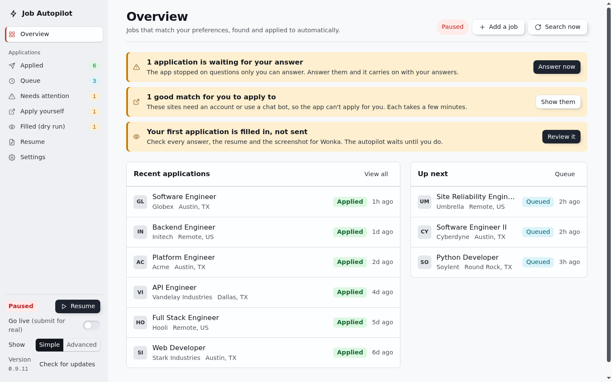
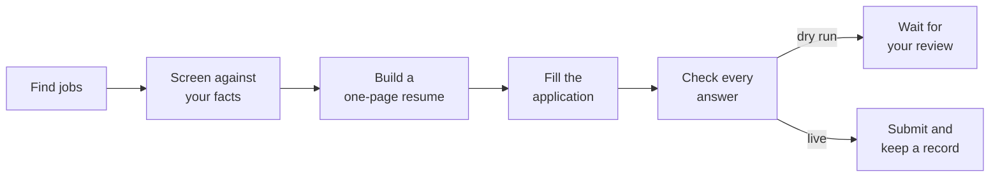
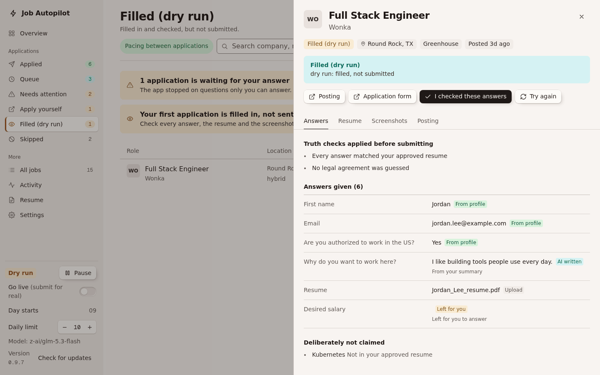
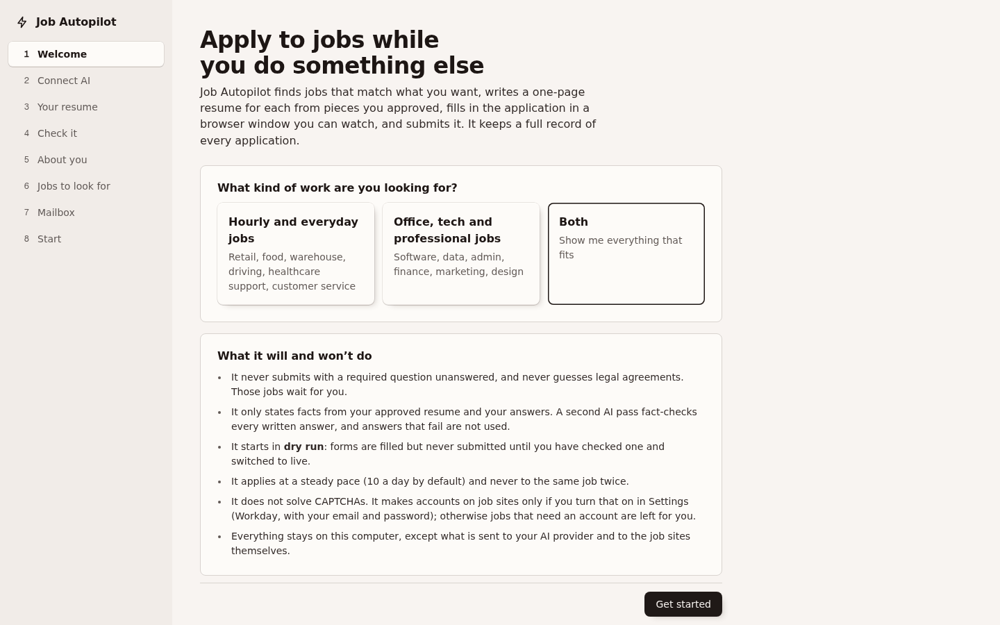
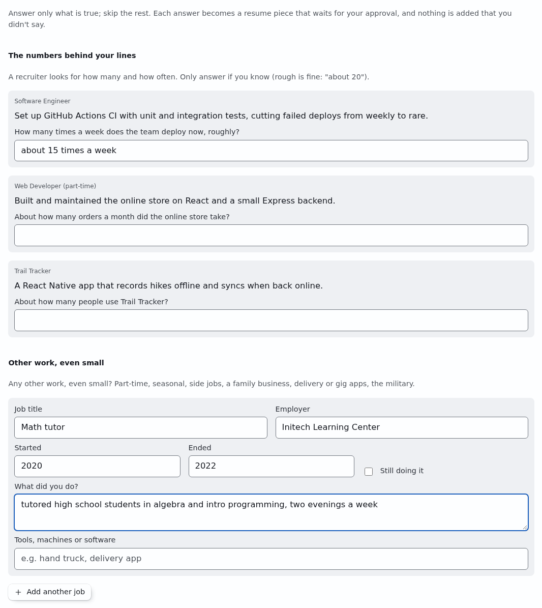
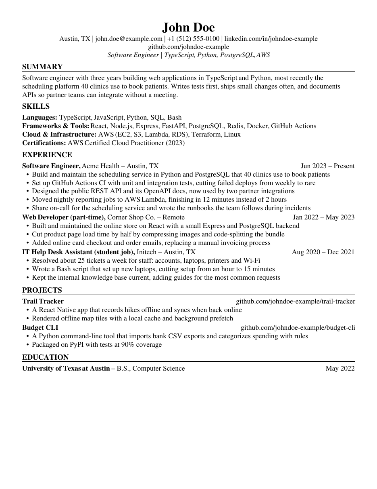

<div align="center">


# Job Autopilot

**Finds jobs that fit you, writes an honest one-page resume for each one, and applies for you.**<br>
For hourly and everyday jobs as well as office and tech work. Desktop app for macOS and Windows.

[](https://github.com/AntonyPerez0/job-autopilot-desktop/releases/latest)
[](https://github.com/AntonyPerez0/job-autopilot-desktop/releases)
[](https://github.com/AntonyPerez0/job-autopilot-desktop/actions/workflows/ci.yml)
[](#download)
[](LICENSE)

[**Download**](#download) · [How it works](#how-it-works) · [Features](#features) · [Your resume](#making-and-improving-your-resume) · [Privacy](#privacy) · [FAQ](#faq)

<br>

<picture>
  <source media="(prefers-color-scheme: dark)" srcset="docs/images/overview-dark.png">
  
</picture>

<br><br>

**The 60-second tour**: every step from the first setup screen to going live.

https://github.com/user-attachments/assets/18073345-3718-43e3-89f1-352ddd10d98b

</div>

<br>

> [!IMPORTANT]
> **It starts in dry run.** Forms get filled in, but nothing is sent until you
> have checked a filled application yourself and switched it to live. It never
> states anything you didn't tell it, never guesses a legal agreement, and never
> applies to the same job twice.

## How it works



1. **You tell it once** what you've done and what you want: upload a resume, or
   answer a short interview and it writes one with you. You approve every line.
2. **Every two hours** it searches for jobs that match your titles, city and
   pay floor, and reads each posting against your facts.
3. **For each good fit** it builds a one-page resume from your approved pieces,
   fills in the application in its own browser window, and checks every answer.
4. **Anything only you can answer** (a legal agreement, a question it can't back
   up with your facts) waits for you. Answer it once, and it's reused next time.

## Features

<table>
<tr>
<td width="50%" valign="top">

**Applies for you, at a steady pace**<br>
Greenhouse, Lever, Ashby, SmartRecruiters, Workable and many more, including
forms spread over several pages. 10 applications a day by default, 6 minutes
apart. Workday accounts too, if you turn it on.

</td>
<td width="50%" valign="top">

**Resumes recruiters read**<br>
A recruiter's pass on every resume: the strongest lines first, professional
wording of your own facts, a headline and summary, grouped skills. A score out
of 10 with line-by-line notes, and a version for each kind of job.

</td>
</tr>
<tr>
<td valign="top">

**Honest by design**<br>
The AI may only reword what you said. Rules with no AI involved reject any
number, tool or claim you didn't give, and a second AI pass fact-checks every
line. Nothing is used until you approve it.

</td>
<td valign="top">

**Fills a short resume with real facts**<br>
"Fill out my page" asks about what people usually leave out: other work,
licenses with their year, records and recognition, volunteering, and the
numbers behind your lines. Never filler.

</td>
</tr>
<tr>
<td valign="top">

**Built for everyday jobs**<br>
Cashier, warehouse, driving, food service, healthcare support. "Help me
remember" jogs your memory with the tasks people in your job usually do (from
the U.S. Department of Labor's O*NET), and suggests jobs you already qualify for.

</td>
<td valign="top">

**Private, and cheap to run**<br>
Everything stays on your computer. No accounts, no analytics. Use your own AI
key (about a cent per application) or a free model on your own computer.

</td>
</tr>
</table>

<table>
<tr>
<td width="50%" valign="top" align="center">
<br>
<sub><b>Review a filled application.</b> Every answer, where it came from, and what it deliberately didn't claim.</sub>
</td>
<td width="50%" valign="top" align="center">
<br>
<sub><b>A guided setup</b> for people who've never used a tool like this.</sub>
</td>
</tr>
<tr>
<td valign="top" align="center">
<br>
<sub><b>Fill out my page.</b> Plain questions; every answer becomes a line you approve.</sub>
</td>
<td valign="top" align="center">
<br>
<sub><b>A finished resume.</b> One page, drawn by the app, for a made-up software engineer.</sub>
</td>
</tr>
</table>

## Download

| | File | Needs |
|---|---|---|
| **macOS** | [`Job-Autopilot-<version>-mac-universal.dmg`](https://github.com/AntonyPerez0/job-autopilot-desktop/releases/latest) | Apple Silicon or Intel |
| **Windows** | [`Job-Autopilot-Setup-<version>.exe`](https://github.com/AntonyPerez0/job-autopilot-desktop/releases/latest) | Windows 10 or 11, no admin rights |

You'll also need an AI key: a free [OpenRouter](https://openrouter.ai) account
with $5 of credit covers hundreds of applications, and the setup walks you
through it. Or use a free model on your own computer
([Using a local model](#using-a-local-model)).

These builds are not signed with an Apple or Microsoft certificate yet, so your
computer warns you the first time you open the app. Here's how to get past the
warning once:

<details>
<summary><b>macOS: first launch</b></summary>

1. Open the `.dmg` and drag **Job Autopilot** into **Applications**.
2. Double-click Job Autopilot in Applications. macOS says it "cannot verify"
   the app. Click **Done** (or **Cancel**).
3. Open **System Settings > Privacy & Security**, scroll down to the message
   about Job Autopilot, and click **Open Anyway**. Enter your password if asked.
4. Click **Open** in the dialog that follows. From then on it opens normally.

On older macOS versions you can instead right-click (or Control-click) the app
in Applications, choose **Open**, then **Open** again.

The first time you save your API key, macOS may ask to let Job Autopilot use
your keychain. Click **Always Allow**: that's where the key is kept, encrypted.

</details>

<details>
<summary><b>Windows: first launch</b></summary>

1. Run `Job-Autopilot-Setup-<version>.exe`.
2. If Windows shows **"Windows protected your PC"**, click **More info**, then
   **Run anyway**.
3. Follow the installer. It installs just for you and doesn't need admin
   rights. You'll find Job Autopilot in the Start menu and on your desktop.

</details>

### Updates

The app checks for a new version when it starts and every few hours after.
The sidebar always shows your version. When a new one is out, the sidebar
shows an **Update to x.y.z** button, the Overview shows a banner, and
**Settings > Updates** (at the top of Settings) has **Update now**. **Check for updates**
in either place checks right away. If you already have the latest version,
Update now stays greyed out. Press it and the app does the rest:

1. It downloads the new version and checks it against the release's
   checksums.
2. It lets any application in progress finish.
3. It closes, installs the new version and opens again.

Your data and settings stay as they are.

On a Mac this works when the app is in your Applications folder, not when it's
run straight from the disk image or the Downloads folder. After an update,
macOS may ask once more to let Job Autopilot use your keychain: click **Always
Allow**. That's because these builds aren't signed yet (see
[docs/SIGNING.md](docs/SIGNING.md)). You can always download a version from
Releases by hand and install it over the old one instead.

## Contents

- [First run: the setup](#first-run-the-setup)
- [Making and improving your resume](#making-and-improving-your-resume)
- [Where the jobs come from](#where-the-jobs-come-from)
- [What happens next](#what-happens-next)
- [What it won't do](#what-it-wont-do)
- [Moving to a new computer](#moving-to-a-new-computer-or-reinstalling)
- [Privacy](#privacy) · [What it costs](#what-it-costs) · [Using a local model](#using-a-local-model)
- [Things to know](#things-to-know) · [Troubleshooting](#troubleshooting) · [FAQ](#faq)
- [For developers](#for-developers)

## First run: the setup

The app walks you through a few short steps. Only your name, contact details,
city and work authorization are required; everything else can wait. You can
change all of it later under **Settings** and **Profile**.

1. **Welcome.** Pick the kind of work you want (hourly and everyday jobs,
   office and tech jobs, or both). The app uses it to suggest job titles and
   where to look.
2. **Connect AI.** The app needs an AI model to read postings and fill forms.
   The screen walks you through three steps: make a free
   [OpenRouter](https://openrouter.ai) account, add $5 of credit (enough for
   hundreds of applications), and paste the key. The app tests it the moment
   you paste it. Under **Other ways to connect an AI** you can use another
   service instead, or a free model on your own computer (see
   [Using a local model](#using-a-local-model)).
3. **Your resume.** Drop in one or more resumes (PDF or Word `.docx`). No
   resume? Open **I don't have a resume** and answer a few questions; the app
   writes one with you (see [Making and improving your resume](#making-and-improving-your-resume)).
   Have projects on GitHub? Open **Add projects from my GitHub** (see
   [Projects from GitHub](#projects-from-github)).
4. **Check it.** The app splits your resume into pieces: summaries, bullet
   points, skills, education and a layout. Fix anything that isn't exactly
   true, delete what you'd never send, and approve the rest. **Everything is
   true: approve all** does it in one click once you've read them, except
   lines with a **Check this** note: those stay unticked until you've read and
   ticked each one. Resumes are only ever put together from approved pieces.
   If your resume is short, **Want a fuller page?** at the top asks a few
   questions about what people usually leave out (see
   [Fill out my page](#making-and-improving-your-resume)).
5. **About you.** Name, email, phone, city, whether you're allowed to work in
   the country, whether you'll need a visa sponsor, and whether you're 18 or
   older. The app never answers those for you: you pick each one. Optional
   sections cover the questions forms ask most:
   - when you can work (days, shifts, hours, transportation, lifting, your
     own insured car, a clean driving record, 21 or older)
   - work and school
   - links
   - legal questions
   - voluntary self-identification (declined unless you choose)
   - things you can never claim

   The more you answer, the fewer forms stop to ask you.
6. **Jobs to look for.** Type job titles or click suggestions, pick your city
   from the list, drag the slider for how far you'd travel, and tick remote
   jobs if you want them. Then choose where to look (see
   [Where the jobs come from](#where-the-jobs-come-from)). **More options** has
   company exclusions, posting age and experience limits.

   **Not sure what to look for?** The app suggests jobs from your resume on its
   own when you haven't picked any titles yet (or press **Suggest jobs from my
   resume**). It reads your approved resume and lists job titles you already
   qualify for, matched to the license class you hold (a Class B driver sees
   Class B jobs),
   the ones that tend to pay more than your current work first, each with the
   fact of yours that qualifies you ("You hold a Class B CDL"). Add any with one
   click. To move up in pay, put what you make now in **Lowest pay you'd take**:
   jobs whose posted top rate is lower are skipped (jobs that don't post pay are
   kept), and every job you're shown lists its posted pay. The app tells you if
   the number looks like a yearly salary with "an hour" picked, or the reverse.
   **Want a better job, or a different one?** Press **Move up: what I could do
   next**. The app looks at all your jobs, not just the latest, and at your
   skills, projects and education. It suggests work they point to, even in a
   different field, along with the jobs people in your lines of work usually go
   on to (from the U.S. Department of Labor's O*NET). It keeps the ones that pay
   about the same as yours or more where you live (typical pay from the U.S.
   Bureau of Labor Statistics); the ones at about the same pay are marked, so
   you can change direction without a pay cut. If you know what you'd like to
   move toward ("more coding", "being outdoors"), type it in the box first.
   Each suggestion is checked against your resume:
   - **You could apply for these now**: your resume already shows what most ads
     ask for. One click adds it to your job titles.
   - **One step away**: exactly what's missing (a Class A CDL, a passenger
     endorsement, a certification, the postal exam) and how people usually get
     it, roughly how long and what it costs. That's advice only; nothing goes
     on your resume until you have it.
   - **Not for me** hides a suggestion, and the app leaves it out from then on
     (for example, the kind of work you're trying to leave). **Show the ones you
     hid again** brings them back.
   - When a job title isn't an official group of its own (a "QA Engineer"), the
     app says which official group its pay comes from.
7. **Mailbox (optional).** See [Mailbox](#mailbox).

Then press **Start in dry run**.

## Making and improving your resume

The **Resume** page (in the sidebar) has five parts.

**Check & improve.** A checklist of what a recruiter notices first: one page,
complete contact details, a short summary, lines that start with an action,
no "I" or "my", no buzzwords ("hard-working team player"), consistent dates,
and lines that show size or results. Each item says what to change and why.
**Suggest improvements for every line** (or **Improve these** on one item)
rewrites your lines the way recruiters like them. Each suggestion sits next to
your original. You can **Use this**, **Keep both** (the app never puts both on
one resume), edit it, or say no. When a number would make a line stronger, the
app asks you ("About how many customers did you serve on a typical day?")
instead of guessing. Answer only if you know, and it rewrites the line with
your answer.

**Make a resume with me.** A short interview:
- the job you want next
- each job you've had (including part-time, gig and family work): what you did
  on a normal day, what you're proud of, any numbers you know, and the tools or
  machines you used
- school and training
- certifications, languages and skills

Under each job, **Help me remember what I did** asks a list of yes/no
questions about what people in that kind of job usually do ("Did you count the
cash drawer at the end of a shift?", "Did you help unload deliveries?"). The
questions come from the U.S. Department of Labor's O*NET task lists for that
occupation, put into plain words for that workplace, plus a few common extras
marked "idea". Say **Yes** only to what you really did; you can add how many or
how often if you know. Only your yes answers become lines, and each line shows
what it came from ("You said yes to: ..."). Most people find several things they
forgot.

The app writes two to four lines per job and a short summary. Your skills,
languages and certifications are listed exactly as you typed them. It can
start a new resume or add to the one you have.

Jobs already on your resume get the same thing on the **Check & improve**
part, under **Remember more**: answer the questions, then **Add what I said
yes to**. The new lines wait for your approval.

**Projects from GitHub** is described [below](#projects-from-github).

**All your resume pieces** shows every line, where it came from ("From your
answer: ..."), and whether it's approved. **Add another resume** uploads
another file. **Download my resume (PDF)** saves the general version, for jobs
you apply to yourself.

**The recruiter's pass.** After the creator writes your lines, the app goes over
them the way a recruiter would (the rules, and the research behind them, are in
[docs/resume-research.md](docs/resume-research.md)): the strongest few lines per
job first (up to 5 for your current job, 3 for older ones; the rest stay
available for tailoring), plain professional wording of your own facts ("two new
guys" becomes "two new hires"), a headline under your name, a short summary
aimed at the job you want, and your skills sorted into Licenses &
Certifications, Equipment & Tools, Software & Systems and Languages. Every
number stays exactly as you gave it, with its "about", and a rewording that adds
a claim is thrown out.

On **Check & improve**:
- **Read it like a recruiter** scores a layout out of 10 and lists what is weak,
  line by line, with **Improve this** next to each line. It never suggests adding
  something you didn't do; when a number would help, it says what to ask you.
- **A version for each kind of job** makes a layout for one field ("CDL
  driving", "IT support"): your approved lines that matter most for it, worded
  in that field's terms where the facts allow, with a headline and summary for
  it. It also lists what job ads in that field often ask for that your resume
  doesn't show (a certification, say) as advice; that never goes on the resume.
  New wording waits for your approval, and when the app tailors a resume to a
  posting it starts from the version that fits.

**Fill out my page.** A short resume looks thin to a recruiter, so the app asks
for the real things people usually leave out, never filler. It's on **Check &
improve**, and it's offered right after "Make a resume with me":
- **The numbers behind your lines**: a question for each line that would read
  stronger with a number ("About how many signs did you install a week?").
- **Other work, even small**: part-time, seasonal, gig or family-business work.
- **Licenses and training**: who issued each one and the year, plus anything
  missing (OSHA 10, first aid, flagger...).
- **Records and recognition**: years without a claim, a thank-you letter,
  employee of the month.
- **Volunteering and outside work**, and **school and courses**.

Each answer becomes a resume piece in professional wording that waits for your
approval. A line with a new number, or certifications with their years, takes
the old one's place once you approve it. If the page still has room after that,
older jobs may show a fourth line and the page is set a little larger, so a
strong half page reads as a full one.

**Professional wording.** Lines are written the way a resume in your trade reads,
not the way people talk ("take calls and drive to breakdowns" becomes "respond
to dispatched breakdown and accident calls"). A line that still reads casually
gets one more try; the checklist flags any that remain ("Make these sound like a
resume"). A rewording may never add a claim you didn't make: being in charge
("managed", "led"), a system or software, a result ("reduced", "zero"), or
praise ("calm", "reliable").

**How the app keeps it honest:**
- The AI may only reword what you said. Every line it writes is checked:
  - Rules with no AI involved reject any number, name or tool you didn't give,
    praise you didn't use about yourself ("proven", "expert"), and any rewrite
    that drops a word limiting a claim ("helped", "about", "part-time").
  - A second, separate AI pass then reads each line against your own words.
    New lines it doubts get a **Check this** note naming the doubtful part.
    Rewrites it doubts aren't offered.
- Nothing is used until you approve it, and only approved lines ever reach an
  employer.

### Projects from GitHub

Type your GitHub username (or paste your profile link) and press **Look up my
projects**. The app lists your public projects, with your own best ones ticked
and copies of other people's projects (forks) at the bottom. Tick the ones you
want on your resume, and say for each how it was built:

- **I built it**
- **Mostly with AI coding tools**: the project gets a line saying it was built
  with AI coding agents that you directed. No other line may claim you wrote it
  by hand, and that line always goes with the project on a resume.
- **With other people**: every line must say you contributed or worked with
  others.

GitHub can't tell the app this, so it asks you. Then press **Add the ticked
projects**. The app reads each project's description and README and writes two
or three lines from what they say. The same honesty checks as above apply, and
nothing the README doesn't state gets in: no user counts, results or tools it
doesn't mention. Sentences in a README that try to tell an AI what to write are
ignored, and you're told about them. The projects are added to every resume
layout, unapproved, so check them under **All your resume pieces**.

This uses GitHub's public data, with no login, so private projects don't show
up. GitHub allows about 60 lookups an hour from one network, which is enough for
a few tries (each project takes four).

"Recruiter-friendly" here means the app follows widely shared recruiter advice
(the checklist above). No recruiter reviews your resume, and the app can't
promise any employer will like it.

## Where the jobs come from

| Source | What it has | Notes |
|---|---|---|
| **HiringCafe** (on by default) | Jobs of every kind, collected straight from employers' own career sites | The app reads it in its own browser window like a person would, with one results page per search and a few searches every couple of hours. |
| **freehire** | Office, tech and professional jobs | Off by default for hourly-only searches. |
| **Simplify lists** | New-graduate jobs and internships, mostly tech | Read from Simplify's free lists on GitHub. Simplify's own website forbids automated use, so the app never visits it. |
| **Google Jobs** | What Google's job search shows, from many sites | Google has no public jobs API and blocks automated searches, so this goes through [SerpApi](https://serpapi.com) with your own key. Its free plan has 250 searches a month; the app stays under 200 and spreads them over the month. |
| **USAJOBS** | Federal government jobs near you and remote | Through the official USAJOBS listings, with your own free key: press **Get a free key** under USAJOBS, fill in the short form, and paste the key that arrives by email. Applying on USAJOBS needs a Login.gov account and the agency's own questions, so these jobs go to **Apply yourself** with the closing date and a **Make my resume for this job** button. |
| **Add a job** | Anything you find yourself | Copy a job's link from Google, Simplify, HiringCafe, Indeed or a company's site, and paste it into **Add a job** on the Overview. The app applies to it next. |

### Government jobs

- **Federal:** turn on **USAJOBS** (above). Only jobs open to the public are
  searched. Government forms often ask whether you're a U.S. citizen: answer it
  once under About you (it's optional, and never filled in for you).
- **State, county and city:** many come through **HiringCafe** (for example,
  California state departments, cities, counties, school districts and the
  University of California) and **Google Jobs**. Most of these employers take
  applications on sites that need your own account: GovernmentJobs.com,
  CalCareers, EdJoin, a university's job site. Those jobs go to **Apply yourself**
  with **Make my resume for this job**. GovernmentJobs.com doesn't allow apps to
  search or open its pages, so the app never does; paste a link from there into
  **Add a job** and the app takes the job's name from the link.

LinkUp isn't on the list: it closed its public job search in 2024 and now only
sells data to companies.

Every job the app finds goes through the same checks: your titles, your city
and radius, your levels, companies you excluded, and jobs you already applied
to. Then the AI reads it against your facts. Only good fits go on.

### Which jobs the app applies to, and which you apply to

Many employers use application sites that make you **create an account**
first (Workday, iCIMS, Taleo, Oracle, ADP, UKG). Some use a **chat bot**
instead of a form (Paradox's "Olivia"), and some links only lead to a **job
board's** copy of the posting (Indeed, LinkedIn, ZipRecruiter). The app doesn't
chat with bots, and it makes accounts only on Workday and only if you turn that
on (see [Job site accounts](#job-site-accounts-workday)). Good matches on the
other sites go to **Apply yourself**. Open one, apply on the site, then press
**I applied** so it's never suggested again.

### Job site accounts (Workday)

Workday is the most common of those sites, and every company has its own
Workday site with its own account. Settings > **Job site accounts** lets the app
make those accounts for you:

1. Tick **Make accounts and sign in on Workday job sites for me**.
2. Type the email and the password the accounts should use. It's the same
   password on every site, so use one you don't use anywhere else. Workday asks
   for 8 or more characters with upper and lower case, a number and a symbol;
   the app checks that when you save.
3. Tick the box that lets it accept each site's ordinary terms of use and privacy
   policy when it signs up. Arbitration agreements and other legal waivers still
   always wait for you.
4. Connect your mailbox too: Workday emails a link to confirm each new account,
   and the app opens it for you.

Then for each Workday job the app chooses **Apply manually**, makes the account
(or signs in, if it made one there before), confirms it from your email, and
fills every page. In dry run it stops before **Submit**: the filled pages are
saved as a draft in your account on that site, which you can open and check.
Workday jobs already waiting in Apply yourself move to the queue when you turn it
on. Settings lists every account the app made.

Things to know:
- Some job sites' terms may not allow sign-ups by software, and you are
  responsible for the accounts made in your name.
- If you already have an account on a company's Workday site with a different
  password, the app can't sign in there; the job stops and says so.
- A site that shows a CAPTCHA at sign-up still waits for you.
- Workday's own forms vary by company. This has been tested on a practice copy
  of a Workday site, not on real ones yet, so check the first few dry runs.

The app applies by itself on sites that need no account. That includes
Greenhouse, Lever, Ashby, SmartRecruiters, Workable, CareerPlug, Paycom,
Paylocity, JazzHR, BambooHR, Jobvite and many company sites. It handles:

- "Apply" buttons that open the form in a new tab
- cookie banners
- forms spread over several pages

If a site turns out to want a sign-in after all, the job moves to Apply
yourself instead of stopping. For everyday jobs, expect roughly a third to a
half of good matches to be ones the app can do by itself.

### Easy to see and use

- **Text size:** Settings > Appearance has Normal, Larger and Largest, and
  makes everything in the window bigger. Ctrl and + or - (Cmd on a Mac) zooms
  too; Ctrl 0 goes back to your chosen size. On a big screen the text and the
  pages grow to use the space.
- **Light or dark:** Settings > Appearance, or match your computer.
- **Keyboard:** everything works without a mouse. Tab moves through the
  sidebar, the buttons and each job (its title); Enter opens a job; Escape
  closes it and takes you back to where you were. The first Tab offers
  **Skip to the page**.
- **Screen readers:** every button, box and choice has a name, a job opens as
  a dialog, and messages are read out.
- **Checked automatically:** every change is tested against the WCAG 2.2 AA
  accessibility rules (with axe-core) on every page, in light and dark, at a
  small and a large window size, along with the colour contrast of every text
  and background the app uses.

### Simple or Advanced

The app starts in **Simple**: the sidebar shows only the pages most people use
(Overview, the application lists, Resume, Settings), the Overview shows what
needs you and what's next, and extra tools stay out of the way. Switch to
**Advanced** at the bottom of the sidebar (or Settings > Appearance) to see
everything: statistics and activity, Skipped and All jobs, the recruiter's
score, a version of your resume for each kind of job, job site accounts, pace
and browser settings, and your data folder. Nothing changes in how the app
works; only how much it shows.

## What happens next

- Every two hours it searches the sources you picked for your titles and
  places, and checks each new job for fit. Jobs it can apply to go in the
  **Queue**. Good matches on account-only sites go to **Apply yourself**.
- For each queued job, a browser window opens and the app:
  - reads the form
  - builds your resume for that job
  - fills in every answer
  - checks every answer
  - takes screenshots
- **In dry run** it stops before Submit, and on forms with several pages it
  stops before the first **Next** (some sites save an application as soon as
  you press Next). The first filled application shows
  up on the Overview. Open it to see every answer (and where each one came
  from), the resume PDF, the screenshots and the posting. If it's right, press
  **I checked these answers**. If something's wrong, fix your answers in
  Settings.
- **Go live** (the switch in the sidebar) unlocks once you've checked a filled
  application. From then on it submits: 10 a day by default, 6 minutes apart,
  and the daily count resets at 9 AM your time. You can pause it or switch
  back to dry run any time.
- The app only works while it's open. Closing the window stops it. Each
  application takes a few minutes.

The browser is your installed Google Chrome, or Microsoft Edge if you don't
have Chrome. With neither, the app downloads its own Chromium (about 150 MB,
once). The app uses its own browser profile, separate from your everyday one,
so it never sees your bookmarks, passwords or other logins.

The browser stays out of your way while it works, and it stays open between
applications so it doesn't pop up for each one:

- **Windows:** the window is minimized to the taskbar.
- **Mac:** macOS doesn't draw minimized windows, and the app needs the window
  drawn to take its screenshots. So instead the window sits just past the left
  edge of the screen, behind your other windows; a thin sliver may show there.
  When the browser grabs focus (as it starts, or opens a new application), the
  app hands focus straight back to whatever you were using. The browser can
  flash to the front for a split second when that happens.

On the Overview, **Show the browser** brings it up to watch, and **Minimize
it** puts it away again. In Settings > Pace and browser you can instead keep it
in front, or run with no window at all. With no window, some sites are more
likely to ask for an emailed security code.

### When it stops on a question

Some questions only you can answer: years of a particular kind of experience,
whether you're a student, a company's own privacy acknowledgement. The app
stops on those instead of guessing, and a banner on the Overview says how many
are **waiting for your answer**. Open one: **Answer to continue** lists each
question. When it's a list on the form, the app shows the form's own choices to
pick from (it reads them from the page when it stops). Type or pick your answer and press **Save my
answers and try again**. If the app couldn't attach your resume, it says so
instead of asking you a question. The app fills those
questions in exactly as you wrote them and tries that application next.

Short answers are kept for every application that asks the same question,
so you answer it once. Untick **Use this answer for other applications** to
keep one for that job only (long, written answers and questions that name the
company start that way). Settings > **Your answers to form questions** lists
them all, and you can remove any.

## What it won't do

- **Submit an incomplete application.** If a required question has no
  answer, or no answer it can back up with your facts, the job goes to
  **Needs attention** with the reason. Nothing goes out. You answer the
  question in the app and it carries on (see below).
- **Make things up.**
  - Every fact comes from your approved resume pieces and your answers.
  - Truth rules check the questions that matter most against what you
    entered, and correct any AI answer that disagrees:
    - work authorization and sponsorship
    - years of experience
    - how you heard about the job
    - start date and notice period
    - graduation date
    - relocation
    - self-identification
  - A second AI pass fact-checks every written answer. Answers it can't
    confirm aren't used.
  - Anything that mentions something on your "can never claim" list is thrown
    out.
- **Agree to legal terms for you.** These always wait for you:
  - arbitration agreements
  - jury and class-action waivers
  - non-competes and releases of claims
  - questions about criminal history (unless you answered them yourself under
    About you > Legal questions)
  - any "I acknowledge" or "I authorize" question whose fine print gives up
    rights

  Settings lets you allow two things: plain arbitration agreements, and plain
  yes/no background-check and drug-test questions.
- **Apply twice.**
  - The same posting is never applied to again.
  - The same role on another job board, or under a slightly different title,
    counts as the same job.
  - It also skips anything on your "already applied" list.
  - With a mailbox connected, it skips anything an employer has already sent
    you a "thank you for applying" email about.
  - If the app is closed in the middle of pressing Submit, that job is never
    pressed again automatically. It waits for you.
- **Solve CAPTCHAs, or make accounts without your go-ahead.** Accounts are made
  only on Workday, and only once you turn on Job site accounts. Jobs that need
  anything else are skipped or left for you.

### Mailbox

Greenhouse sometimes emails a security code that has to be typed into the
form before it accepts an application. With your mailbox connected, the app
reads the code and finishes the application. Without it, those jobs wait in
Needs attention. The app also uses the mailbox to spot employers' "thank you
for applying" emails.

The connection is read-only: the app never sends, deletes, moves or marks
anything. It needs an **app password**, which is a separate password just for
this app. You can only create one when two-step verification is turned on.

- **Gmail:** turn on 2-Step Verification, then create an app password at
  [myaccount.google.com/apppasswords](https://myaccount.google.com/apppasswords).
- **Yahoo:** go to
  [login.yahoo.com/account/security](https://login.yahoo.com/account/security)
  and choose **Generate app password**.
- **iCloud:** go to [account.apple.com](https://account.apple.com), then
  **Sign-In and Security > App-Specific Passwords**.
- **Outlook.com / Hotmail:** not supported directly. Microsoft stopped
  allowing app passwords for mail apps in September 2024. Instead, forward
  your Outlook mail to a Gmail, Yahoo or iCloud mailbox and connect that one,
  or skip this step.

Use the mailbox that receives mail for the email address you put on your
applications.

## Moving to a new computer, or reinstalling

The app keeps a small file listing every job you applied to:
`Documents/Job Autopilot/applied-jobs.json.gz`. It's rewritten a few seconds
after each application. It only holds the employer, job title, location, the
posting's address and the date (no answers, resumes or screenshots), so even
thousands of applications take a few hundred KB at most. The file only ever
grows, and the previous copy is kept next to it as `.bak`.

- **Reinstalling on the same computer:** your data folder stays where it is, so
  nothing changes. If you wiped it, the setup finds the file in Documents and
  offers **Import my history** on its first screen.
- **A new computer:** copy the file over and press **Import a history file** in
  Settings > Application history, or let the setup find it in Documents. If
  your Documents folder syncs (iCloud Drive, OneDrive), it may already be
  there. You can also pick another folder, such as Dropbox, with **Change
  folder**, or save a dated copy with **Save a copy...**.

Once imported, the app never applies to those jobs again: not the same
posting, not the same address, and not the same role at the same employer on
another job board. Jobs that might have gone through (the app was interrupted
while submitting) come in as Needs attention, never as something to retry.

## Privacy

Everything stays on your computer, in one folder (Settings > Your data > Open
the folder):

- macOS: `~/Library/Application Support/Job Autopilot`
- Windows: `%APPDATA%\Job Autopilot`

That folder holds your profile, answers, preferences, the job list, every
resume that was sent, and the screenshots. The only file kept elsewhere is the
application history described above (you can turn it off in Settings). The API key, the mailbox password and the job-site account password
are encrypted by your operating system's keychain (macOS Keychain, Windows
DPAPI).

The app only sends data to:

- **Your AI provider** (OpenRouter by default): your approved resume pieces
  and answers, plus each posting and its form questions. This is how it
  screens jobs, plans each application and fact-checks answers. With a local
  model (Ollama or LM Studio) this stays on your computer.
- **The job sources you turned on**: the job titles, places and filters you
  search for, and nothing about you. That means freehire.me, HiringCafe
  (searched in the app's browser), GitHub (Simplify's lists) and, with your
  key, SerpApi for Google Jobs.
- **The job sites themselves** (the employers and their application sites):
  the application you send, and, with Job site accounts on, the email and
  password the app signs up and signs in with on Workday sites.
- **Your mailbox** (if connected): read-only access over IMAP.
- **GitHub**: a check for new versions, and, if you use **Projects from
  GitHub**, your username, to read your public projects. Chromium is downloaded from
  Playwright's servers, and only if you have neither Chrome nor Edge.

There are no analytics and no accounts, and nothing goes to the author of this
app.

## What it costs

The app is free. With a local model, the AI costs nothing either. Otherwise
you pay your AI provider for what it uses, on your own key.
Each posting it screens is one short AI call. Each application is two or three
longer ones (the plan, then the fact-check), roughly 10,000 to 20,000 tokens
in all. With a small, cheap model like the default `z-ai/glm-5.3-flash`, that
usually comes to a cent or less per application. Bigger models cost more. The
model's price is shown on OpenRouter, and your actual usage is on your
provider's dashboard. Setting a spending limit on the key is a good idea.

## Using a local model

Instead of a paid AI service, the app can use a model running on your own
computer. Nothing about you leaves the computer for the AI steps, and there's
nothing to pay per use. The trade-offs:

- It needs a capable computer: 16 GB of memory or more, ideally a recent Mac
  or a PC with a graphics card.
- It needs a model that follows instructions well, about 14 billion parameters
  or more (for example Qwen 3 14B or Gemma 3 12B). Small models skip more jobs
  and leave more questions for you. The truth rules, the fact-check and the
  never-submit-incomplete gate apply all the same.
- Each application can take several minutes instead of under a minute.

**Ollama:** install it from [ollama.com](https://ollama.com/download), start
it, and download a model (for example `ollama pull qwen3:14b` in a terminal).
In the app choose **Ollama, on this computer**, press **Find models**, pick
one, and press **Test**. The app asks Ollama for a 16,384-token context window,
enough for a posting and your resume; you can raise it in the same place.

**LM Studio:** install it from [lmstudio.ai](https://lmstudio.ai) and download
a model. In its Developer tab, load the model with a **context length of 16384
or more** and start the server. In the app choose **LM Studio, on this
computer**, press **Find models**, pick one, and press **Test**.

**Test** also checks that the model can keep track of a long posting. If it
can't, the app says so and won't continue until the context window is larger.
Other local servers (llama.cpp, Jan, vLLM...) work through "Another
OpenAI-compatible API" with their `http://localhost:.../v1` address and no key.

## Things to know

- **Job sites' terms.** Some job sites and employers don't allow automated
  applications, and some employers may treat them differently. You're
  responsible for every application sent in your name. That's why the app
  starts in dry run, keeps a steady pace and records everything.
- **Sites change.** Application sites change their forms from time to time. When a form can't be filled correctly, the app stops and puts the job
  in Needs attention instead of sending something half-done.
- **Some sites guess things.** A few application sites pre-fill your location
  from your internet connection. The app replaces a guessed city with yours,
  and notes it in that job's record.
- **The AI can still be wrong.** The truth rules only cover the common
  questions listed above. Other answers depend on the fact-check and on your
  review. Look through the Answers tab of a few applications now and then.

## Troubleshooting

- **"Your AI account is out of credit."** Add a few dollars at
  [openrouter.ai](https://openrouter.ai) (Settings, then Credits). The app
  shows this on the Overview too when it can't check the jobs a search found.
- **Writing my resume takes a while.** Usually 1 to 3 minutes; the screen shows
  each step as it happens. When the AI service is busy it can take longer, and a
  stuck request is retried on its own.
- **"The key did not work."** Check you copied the whole key and that your
  OpenRouter account has credit. For other providers, check the API address
  ends in `/v1`.
- **"The last search found nothing: HiringCafe could not be searched."** The
  site would not let the app's browser in, or did not load. Press **Search
  now** to try again; if it keeps happening, turn on another place to look in
  Settings > Jobs to look for.
- **Only two of a chain's jobs show up.** When one employer posts the same job
  for many stores ("Delivery Driver" at twenty locations), the app keeps two,
  so the queue isn't twenty copies of one job.
- **Nothing gets queued.** The Overview says when the next search is and the
  main reasons jobs were left out ("8 need a Class A CDL"); **See why** opens
  **Skipped** with each job's reason.
  Add more job titles (or click the suggestions), drag the distance slider
  further, tick more levels, turn on more places to look, or raise the maximum
  years required under More options.
- **Most matches are in Apply yourself.** That's normal for everyday jobs:
  many big employers use sites that need an account. Those take a few minutes
  each by hand.
- **Lots of jobs in Needs attention with "Missing info."** Open one and
  answer the questions under **Answer to continue**; see
  [When it stops on a question](#when-it-stops-on-a-question). For facts that
  many forms ask (a street address, years of experience), filling them in
  under Settings > About you also helps.
- **"Email code needed."** Connect your mailbox in Settings. Those jobs retry
  on their own.
- **"The application browser is already open."** Close the extra browser
  window the app opened, or restart the app.
- **The browser doesn't start.** In Settings > Pace and browser, press **Check
  browsers**. If Chrome and Edge aren't found, press **Download Chromium now**
  (you need a connection that allows downloads from `cdn.playwright.dev`).
- **macOS says the app is damaged.** Make sure you dragged it into
  Applications first. If it still says so, open Terminal and run
  `xattr -cr "/Applications/Job Autopilot.app"`, then open it again.
- **Start over.** Settings > Your data > **Run the setup again**. To wipe
  everything, quit the app and delete the data folder listed above.

## FAQ

<details>
<summary><b>Will it make things up to get me the job?</b></summary>

No. Every fact comes from your approved resume pieces and your answers. Rules
with no AI involved reject numbers, tools, praise and claims you didn't give,
truth rules correct the questions that matter most (work authorization, years
of experience, start date...), and a second AI pass fact-checks every written
answer. Anything it can't back up waits for you. See
[What it won't do](#what-it-wont-do).

</details>

<details>
<summary><b>Do I need a resume to start?</b></summary>

No. Choose **I don't have a resume** in the setup and answer a few questions in
your own words. The app writes one with you, asks yes/no questions to help you
remember what you did, and you approve every line.

</details>

<details>
<summary><b>Does it work for hourly jobs, not just tech?</b></summary>

Yes. That's what it was built around: retail, food service, warehouse, driving,
healthcare support, customer service, and office and tech jobs too. Many big
employers use sites that need an account; the app makes those on Workday if you
turn it on, and lists the rest under **Apply yourself**.

</details>

<details>
<summary><b>How much does it cost?</b></summary>

The app is free and open source. You pay your AI provider for what it uses,
usually a cent or less per application with the default model, or nothing with
a local model. See [What it costs](#what-it-costs).

</details>

<details>
<summary><b>Is my data sent anywhere?</b></summary>

Only to your AI provider, the job sources you turn on, and the job sites you
apply to. Nothing goes to the author of this app, and there are no analytics.
See [Privacy](#privacy).

</details>

<details>
<summary><b>Does it work on Linux?</b></summary>

There's no Linux installer. Developers can run it from source with `npm start`
(see [For developers](#for-developers)).

</details>

<details>
<summary><b>Is using it allowed by job sites?</b></summary>

Some job sites and employers don't allow automated applications. You're
responsible for every application sent in your name, which is why the app starts
in dry run, keeps a steady pace and records everything. See
[Things to know](#things-to-know).

</details>

## For developers

```sh
npm ci
npx playwright-core install chromium   # for the form-filling tests
npm test                               # unit tests and form-fill tests in Chromium
npm run e2e                            # walks the first-run setup in the real app (mock AI)
npm start                              # runs the app from source
JA_API_KEY=... node scripts/live-dry-run.mjs   # one dry run against a live posting, example profile
JA_API_KEY=... node test/e2e/live-in-app.mjs <freehire-slug>   # the same, inside the real app
JA_API_KEY=... node scripts/live-studio.mjs     # resume creator and improver with the real AI
JA_API_KEY=... node scripts/live-recall.mjs     # "Help me remember" questions and lines from yes answers
JA_API_KEY=... node scripts/live-github.mjs <user> <repo> [me|ai|team]   # GitHub projects with the real API and AI
JA_API_KEY=... node scripts/live-hourly.mjs     # HiringCafe search + screen + one dry run (JA_URL=<link> for a given job)
```

How the code is laid out:

- `core/`: the engine.
  - discovery (`discover.js`, `geo.js`)
  - applying (`apply.js`, `browser.js`)
  - the user's facts, truth rules and fact-check (`facts.js`, `truth.js`,
    `engine.js`)
  - mail (`mail.js`)
  - never-twice checks (`dedupe.js`)
  - the loop (`worker.js`)
  - the window's API (`api.js`)
- `main/`: the Electron shell.
- `core/studio.js`: the resume creator, improver, checklist and honesty checks.
- `ui/`: the setup wizard and the dashboard.
- `vendor/apply-helper/`: the Apply Helper add-on's tailoring, PDF and
  form-filling scripts, used unchanged (see `VENDORED.md`).

Installers are built by GitHub Actions (`.github/workflows/release.yml`) on
macOS and Windows runners. The workflow installs each one, launches it and
runs the setup end to end. Pushing a `v*` tag attaches the installers to a
GitHub Release. Signing is described in [docs/SIGNING.md](docs/SIGNING.md).

Place data © [GeoNames](https://www.geonames.org), CC BY 4.0. Typical pay: U.S. Bureau of Labor Statistics,
Occupational Employment and Wage Statistics, May 2025 (public domain). Job task lists, related
occupations and job zones
from the [O*NET 31.0 Database](https://www.onetcenter.org/database.html) by the
U.S. Department of Labor, Employment and Training Administration (USDOL/ETA),
used under [CC BY 4.0](https://creativecommons.org/licenses/by/4.0/); the app
keeps only task statements and job titles, and the AI rewords tasks into
questions. O*NET® is a trademark of USDOL/ETA. pdf-lib, unpdf,
mammoth, imapflow, mailparser and playwright-core are used under their own
licenses.

## Contributing

Issues and pull requests are welcome. Run `npm test` and `npm run e2e` before
sending a change, and keep the honesty rules intact: the app never states a fact
the user didn't give.

## License

[MIT](LICENSE). Made for people looking for work.
